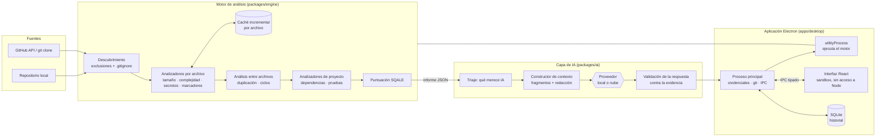

# Fase 1 — Viabilidad y arquitectura

## 1. Viabilidad técnica

El proyecto es viable con un equipo pequeño si se respeta una regla: **el núcleo es un
motor de análisis determinista y la IA es una capa encima**, no al revés.

| Capacidad | Viabilidad | Cómo se consigue |
|---|---|---|
| Complejidad, tamaño, anidamiento (JS/TS) | Alta | TypeScript Compiler API: AST exacto, sin ejecutar código |
| Duplicación de código | Alta | Tokens del escáner de TypeScript + *winnowing* (huellas cacheables) |
| Ciclos y acoplamiento entre módulos | Alta | Grafo de importaciones + componentes fuertemente conexos (Tarjan) |
| Secretos incrustados | Alta | Formatos conocidos + entropía, con evidencia redactada |
| Higiene de dependencias | Alta | Lectura de manifiestos (sin red) |
| Dependencias desactualizadas y vulnerabilidades | Media | Requiere red: registro npm y base OSV (fase 6) |
| Errores potenciales y malas prácticas | Media | ESLint / Semgrep como analizadores enchufables (fase posterior) |
| Otros lenguajes | Media | Tamaño, marcadores y secretos ya; AST por lenguaje es trabajo incremental |
| Cobertura real de pruebas | Baja | Exige ejecutar pruebas de terceros: **no se hace**. Se usa una heurística declarada |
| Explicación y priorización con IA | Alta | Sobre hallazgos estructurados, no sobre el repositorio entero |
| Correcciones generadas por IA | Media | Útiles como propuesta revisable; nunca se aplican sin confirmación |

## 2. Riesgos principales y mitigación

| Riesgo | Impacto | Mitigación |
|---|---|---|
| La IA inventa errores o métricas | Pérdida de confianza en el producto | Evidencia solo de herramientas; salida estructurada validada; toda afirmación debe citar un hallazgo existente |
| Inyección de instrucciones desde archivos del repositorio | La IA obedece texto malicioso | El código se trata como dato no confiable, delimitado; el modelo no tiene herramientas con efectos; validación de salida |
| Fuga de código o secretos a proveedores externos | Incumplimiento de privacidad | Modos de privacidad por repositorio, redacción de secretos antes de enviar, opción solo-local |
| Repositorios grandes agotan RAM/CPU | Aplicación inutilizable | Recorrido en streaming, lectura archivo a archivo, concurrencia limitada, caché incremental, límites de tamaño |
| Falsos positivos | Ruido, el usuario ignora el panel | Umbrales conservadores, nivel de confianza explícito, severidad reducida en código de pruebas |
| Coste de la IA en la nube | Facturas inesperadas | IA solo para hallazgos relevantes, caché, presupuesto por análisis, registro de tokens |
| Ejecución de código de terceros | Compromiso del equipo | El motor solo lee archivos; no instala dependencias ni ejecuta scripts |
| Rutas maliciosas (enlaces simbólicos, `..`) | Lectura fuera del repositorio | No se siguen enlaces simbólicos; toda ruta se valida contra la raíz |
| Alcance excesivo | El proyecto no termina | MVP acotado (sección 5) y fases con entregables verificables |

## 3. Arquitectura general

### Flujo de un análisis

1. **Fuente.** El usuario elige una carpeta o un repositorio de GitHub. Los repositorios
   remotos se clonan en un directorio de la aplicación con `git clone --depth` (fase 6).
2. **Descubrimiento.** Se recorre el árbol podando `node_modules`, `dist`, `build`, `.git`,
   etc. y lo que indique `.gitignore`. Solo se recogen metadatos (tamaño, fecha).
3. **Análisis por archivo.** Cada archivo se lee una vez; el AST se construye una vez y lo
   comparten los analizadores. Si tamaño y fecha coinciden con la caché, ni se lee.
4. **Análisis entre archivos.** Duplicación y ciclos trabajan sobre *artefactos* pequeños y
   cacheables (huellas, listas de importaciones), no sobre el código completo.
5. **Proyecto.** Manifiestos de dependencias y proporción de pruebas.
6. **Informe.** Hallazgos ordenados, puntuación, cobertura del análisis (qué no se analizó)
   y estadísticas de recursos. Es JSON con esquema versionado.
7. **IA (opcional).** Se seleccionan los hallazgos que merecen explicación, se construye un
   contexto mínimo y redactado, se consulta el proveedor configurado y la respuesta se
   valida antes de mostrarse.
8. **Interfaz.** La aplicación guarda el informe en SQLite, muestra la evolución y permite
   revisar propuestas de corrección como diferencias (*diff*) antes de aplicarlas.

### Módulos

| Paquete | Responsabilidad | Depende de |
|---|---|---|
| `packages/engine` | Motor determinista. Sin Electron, sin red | `typescript`, `ignore` |
| `packages/sources` | Git endurecido, clonado y API de GitHub, OSV, registro npm | `engine`, `semver` |
| `packages/ai` | Proveedores de IA intercambiables, contexto, privacidad y validación | `engine`, `sources` (HTTP) |
| `packages/pipeline` | Análisis completo: origen, motor, contexto de Git, dependencias en línea e IA (añadido en la fase 8) | `engine`, `sources`, `ai` |
| `packages/cli` | Comando `radar-deuda`: opciones de la terminal e impresión | `pipeline` |
| `apps/desktop` (fase 8) | Electron + React + SQLite; detalle en [ESCRITORIO.md](ESCRITORIO.md) | `pipeline` y los demás |

El motor no conoce la interfaz ni la IA. Esto permite usarlo desde la terminal y en CI, y
probarlo de forma aislada.

## 4. Estrategia de IA (local y nube)

Resumen; el detalle se implementa en la fase 7.

- **Interfaz única de proveedor** (`LlmProvider`) con adaptadores:
  - API compatible con OpenAI: cubre OpenAI y servidores locales (LM Studio, Ollama,
    llama.cpp), por lo que un solo adaptador da soporte local y remoto.
  - Anthropic (API de Messages).
  - Ollama nativo, si hace falta gestionar modelos.
- **Selección por tarea**: un modelo pequeño (local o barato) para explicar hallazgos
  individuales y uno más capaz para causa raíz, plan de reducción y propuestas de código.
- **Modos de privacidad por repositorio**:
  - `local` — nada sale del equipo.
  - `metadatos` — se envían métricas, rutas y reglas, nunca código.
  - `fragmentos` — fragmentos acotados alrededor del hallazgo, con secretos redactados.
- **Triaje antes de gastar**: solo hallazgos de severidad media o superior, o de confianza
  baja que necesiten una segunda opinión. Nunca "un prompt por archivo".
- **Defensa ante inyección**: el código va delimitado como dato no confiable; el modelo no
  tiene herramientas con efectos; la salida es JSON validado con esquema; cada afirmación
  debe referenciar un `findingId` y líneas que existan.
- **Caché** por (hallazgo, hash del contenido, modelo, versión del prompt).
- **Presupuesto**: límite de tokens y de coste por análisis; registro de consumo.

## 5. MVP (alcance realista)

**Incluido**

- Motor determinista para JS/TS: complejidad, tamaño, duplicación, ciclos, acoplamiento,
  secretos, marcadores, higiene de dependencias y proporción de pruebas.
- Caché incremental, cancelación, concurrencia limitada, métricas de recursos.
- CLI con salida legible y JSON, y código de salida para CI (`--fail-on`).
- Puntuación de mantenibilidad con metodología documentada.
- Clonado de repositorios públicos y privados de GitHub con token de permisos mínimos.
- Vulnerabilidades conocidas vía OSV.
- Capa de IA con dos adaptadores (compatible con OpenAI y Anthropic), explicación y
  priorización de hallazgos, y chat con contexto del informe.
- Aplicación Electron: proyectos, análisis con progreso, panel de hallazgos, detalle con
  explicación de IA, historial.

**Fuera del MVP** (fases posteriores)

- AST para lenguajes distintos de JS/TS.
- Integración de ESLint/Semgrep como analizadores.
- Aplicación automática de correcciones (solo se mostrarán como *diff*).
- Embeddings y recuperación semántica (solo si la búsqueda por símbolos no basta).

## 6. Objetivos de rendimiento

Medidos con `npm run bench` sobre repositorios sintéticos (fase 5) y reales (fase 11).

| Escenario | Objetivo |
|---|---|
| Repositorio pequeño (≈100 archivos) en frío | < 1 s |
| Repositorio mediano (≈1 000 archivos, ≈100 k líneas) en frío | < 10 s |
| Reanálisis sin cambios (caché caliente) | ≤ 25 % del tiempo en frío |
| Memoria del motor (RSS pico, repositorio mediano) | < 512 MB |
| La interfaz nunca se bloquea durante un análisis | El motor corre en un `utilityProcess` |

Resultados medidos y cómo reproducirlos: [RENDIMIENTO.md](RENDIMIENTO.md).
