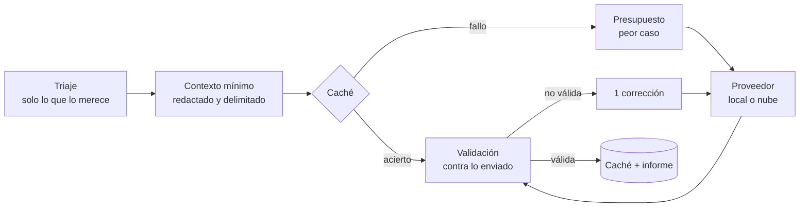

# Fase 7 — Capa de IA con proveedores intercambiables

La IA **explica, relaciona y prioriza** los hallazgos del motor. No los produce ni los
modifica: la evidencia verificable siempre es la de las herramientas. Las propuestas de
código, la vista comparativa y el chat llegan en la fase 9 sobre esta misma capa.

## Qué necesitas para usarla

Elige **una** opción. El análisis funciona igual sin IA.

### Opción A — Modelo local con LM Studio (recomendada: nada sale del equipo)

1. Abre LM Studio y descarga un modelo **instruct de al menos 7B parámetros** (los más
   pequeños no siguen bien la salida estructurada, según la propia documentación de LM
   Studio). Orientación por memoria de la tarjeta gráfica (VRAM), según guías de 2026:

   | VRAM | Tamaño orientativo | Familias habituales |
   |---|---|---|
   | 8 GB | 7–9B en Q4_K_M | Qwen3 8B, Qwen3.5 9B |
   | 12 GB | 12–14B en Q4/Q5 | Qwen3 14B, Gemma 4 12B |
   | 16 GB | 20–24B | Devstral Small 2 24B, gpt-oss-20b |
   | 24 GB | 27–32B | Qwen3-Coder-30B-A3B, Qwen3 32B |

   Sin GPU dedicada también funciona en CPU con un modelo de 7–9B, pero cada explicación
   puede tardar varios minutos.
2. Al cargar el modelo, usa una **longitud de contexto de al menos 8 192 tokens**: cada
   consulta envía hasta ~4 000 tokens de contexto más las instrucciones y la respuesta.
3. Inicia el servidor: pestaña **Developer → Start server** (puerto 1234), o en PowerShell:
   ```powershell
   lms server start
   ```
4. Analiza:
   ```powershell
   npm run analyze -- C:\dev\mi-proyecto --ai lmstudio
   ```
   Se usa el primer modelo cargado; otro con `--ai-model <id>`.

Con Ollama es igual: `--ai ollama` (puerto 11434). Cualquier servidor compatible con la
API de OpenAI sirve con `--ai url --ai-url http://localhost:PUERTO/v1`.

### Opción B — Claude en la nube (Anthropic)

1. Crea una clave de API en la Claude Console y **define un límite de gasto** para ella.
2. Defínela solo para la sesión, sin que quede en el historial de PowerShell:
   ```powershell
   $s = Read-Host "Clave de Anthropic" -AsSecureString
   $env:RADAR_ANTHROPIC_API_KEY = [Runtime.InteropServices.Marshal]::PtrToStringAuto([Runtime.InteropServices.Marshal]::SecureStringToBSTR($s))
   Remove-Variable s
   ```
3. Analiza (por defecto **solo metadatos, sin código**):
   ```powershell
   npm run analyze -- C:\dev\mi-proyecto --ai anthropic
   npm run analyze -- C:\dev\mi-proyecto --ai anthropic --privacy fragmentos   # explícito: envía fragmentos redactados
   ```

Modelos: `claude-haiku-5-5` explica cada hallazgo y `claude-sonnet-5-5` genera el plan.
Coste orientativo con los precios de octubre de 2026 (8 explicaciones de ~4 000 tokens de
entrada y ~600 de salida, más un plan de ~6 000 / 1 500): **unos 0,03 USD por análisis**. El
presupuesto por defecto es 0,50 USD (`--ai-budget`) y el informe muestra el coste real.

OpenAI también está soportado (`--ai openai --ai-model <id>`, clave en `RADAR_OPENAI_API_KEY`).

### Comprobar que funciona en tu equipo

```powershell
$env:RADAR_LIVE_LLM = "lmstudio"
npx vitest run packages/ai/test/live.test.ts
Remove-Item Env:RADAR_LIVE_LLM
```

La prueba analiza `examples/demo-repo` con tu modelo e imprime las explicaciones validadas.

## Qué sale del equipo

| `--privacy` | Proveedores permitidos | Qué se envía |
|---|---|---|
| `local` (por defecto con LM Studio/Ollama) | Solo locales (`localhost`) | Datos del hallazgo y fragmentos de código |
| `metadatos` (por defecto en la nube) | Cualquiera | Regla, métricas, mensaje, rutas y símbolos. **Nunca código** |
| `fragmentos` | Cualquiera | Lo anterior y fragmentos acotados alrededor del hallazgo |

En todos los modos:

- un hallazgo de secretos **nunca** envía código, y cualquier línea con un posible secreto se
  sustituye por `[línea omitida: posible secreto]` antes de enviarla;
- se envía un resumen del proyecto (tamaño, nombres de dependencias), nunca el repositorio;
- un servidor en otro equipo de la red se trata como nube.

## Cómo se evita que la IA invente



1. **Evidencia de herramientas primero.** El modelo recibe hallazgos ya verificados.
2. **Cada afirmación se etiqueta** como evidencia, inferencia o recomendación, y la
   validación lo comprueba:
   - una cita de líneas que no se enviaron **no es evidencia**;
   - una "evidencia" con cifras que no aparecen en los datos enviados se degrada a
     inferencia (posible cifra inventada);
   - una "evidencia" sin cita ni dato verificable también;
   - con correcciones o información insuficiente, la confianza no puede ser alta.
3. **Defensa ante inyección.** El código va delimitado como dato no confiable con un
   identificador derivado del contenido; cualquier `<<<`/`>>>` del repositorio se neutraliza.
   El modelo no tiene herramientas: aunque obedeciera un texto malicioso, solo podría
   devolver texto, que se valida.
4. **Salida estructurada** (JSON Schema) cuando el proveedor la soporta; si no, se valida
   igualmente. Si la respuesta no es válida se pide **una** corrección; si tampoco lo es, se
   informa del fallo. Nunca se muestra una respuesta sin validar.
5. **El plan** solo puede referirse a hallazgos existentes.

## Consumo y rendimiento

- **Triaje:** por defecto 8 hallazgos (`--ai-limit`) de severidad media o superior, o de
  confianza baja; primero los de puntos críticos. Nunca una consulta por archivo.
- **Caché** en `%LOCALAPPDATA%\radar-deuda\cache\ai`: la clave incluye versión de las
  instrucciones, proveedor, modelo, privacidad y el contexto exacto. Un reanálisis sin
  cambios no hace ninguna petición.
- **Presupuesto** comprobado antes de cada petición con el peor caso (entrada estimada +
  salida máxima): peticiones, tokens y coste.
- **Concurrencia:** 1 petición a la vez con modelos locales y 4 en la nube.
- **Tiempos límite:** 5 min por petición local y 2 min en la nube; `Ctrl+C` cancela.
- El informe muestra peticiones, tokens, coste, latencia máxima y aciertos de caché.

## Arquitectura

| Módulo | Responsabilidad |
|---|---|
| `provider.ts` | Interfaz `LlmProvider` y errores clasificados |
| `providers/openai-compatible.ts` | OpenAI, LM Studio, Ollama, llama.cpp |
| `providers/anthropic.ts` | API de Messages (versión `2026-10-21`, salida estructurada) |
| `context.ts` | Privacidad, fragmentos, redacción, delimitadores |
| `schemas.ts` · `validate.ts` | Esquemas de salida y validación contra la evidencia |
| `usage.ts` · `cache.ts` | Presupuesto, precios, concurrencia, caché |
| `runner.ts` · `tasks.ts` | Consulta con reintento correctivo, triaje, explicación y plan |

Añadir un proveedor = implementar `LlmProvider` (`complete` y, opcionalmente,
`listModels`). El resto no cambia.

## Limitaciones conocidas

- La validación detecta citas y cifras no respaldadas, pero no puede verificar cada matiz
  semántico de una explicación: por eso todo se presenta como orientativo y separado de la
  evidencia.
- Los modelos locales pequeños pueden producir JSON incompleto; el reintento correctivo lo
  mitiga, y si falla el hallazgo aparece en "Sin completar".
- El plan considera como mucho los 40 primeros hallazgos (por severidad).
- Los precios de la tabla son los publicados el 2026-10-25; si cambian, el coste informado
  será aproximado (los límites de tokens siguen aplicándose).
