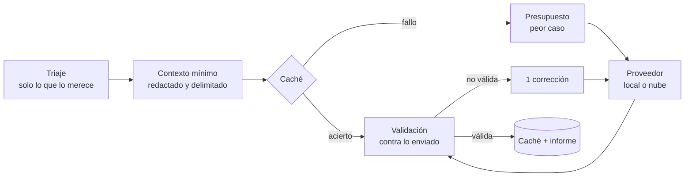

# Fase 7 — Capa de IA con proveedores intercambiables

La IA **explica, relaciona y prioriza** los hallazgos del motor. No los produce ni los
modifica: la evidencia verificable siempre es la de las herramientas. La fase 9 añade sobre
esta misma capa las [propuestas de corrección y las preguntas sobre el análisis](#fase-9--propuestas-de-corrección-y-preguntas).

## Qué necesitas para usarla

Elige **una** opción. El análisis funciona igual sin IA. En la CLI, las claves se leen
solo de variables de entorno con prefijo `RADAR_` y nunca se escriben en disco. En la
aplicación de escritorio todo se elige en Configuración y las claves se guardan cifradas
con el sistema ([ESCRITORIO.md](ESCRITORIO.md)); lo que sigue usa la CLI.

### Opción A — Modelo local con LM Studio (recomendada: nada sale del equipo)

1. Abre LM Studio y descarga un modelo **instruct de al menos 7B parámetros** (los más
   pequeños no siguen bien la salida estructurada, según la propia documentación de LM
   Studio). Orientación por memoria de la tarjeta gráfica (VRAM), según guías de 2026:

   | VRAM | Tamaño orientativo | Familias habituales |
   |---|---|---|
   | 8 GB | 7–9B en Q4_K_M | Qwen3 8B, Qwen3.5 9B |
   | 12 GB | 12–14B en Q4/Q5 | Qwen3 14B, Gemma 4 12B |
   | 16 GB | 20–24B | Devstral Small 2 24B, gpt-oss-20b |
   | 24 GB | 27–32B | Qwen3-Coder-30B-A3B, Qwen3 32B |

   Sin GPU dedicada también funciona en CPU con un modelo de 7–9B, pero cada explicación
   puede tardar varios minutos.
2. Al cargar el modelo, usa una **longitud de contexto de al menos 8 192 tokens**: cada
   consulta envía hasta ~4 000 tokens de contexto más las instrucciones y la respuesta.
3. Inicia el servidor: pestaña **Developer → Start server** (puerto 1234), o en PowerShell:
   ```powershell
   lms server start
   ```
4. Analiza:
   ```powershell
   npm run analyze -- C:\dev\mi-proyecto --ai lmstudio
   ```
   Se usa el primer modelo cargado; otro con `--ai-model <id>`.

Con Ollama es igual: `--ai ollama` (puerto 11434). Cualquier servidor compatible con la
API de OpenAI sirve con `--ai url --ai-url http://localhost:PUERTO/v1`.

### Opción B — Claude en la nube (Anthropic)

1. Crea una clave de API en la Claude Console y **define un límite de gasto** para ella.
2. Defínela solo para la sesión, sin que quede en el historial de PowerShell:
   ```powershell
   $s = Read-Host "Clave de Anthropic" -AsSecureString
   $env:RADAR_ANTHROPIC_API_KEY = [Runtime.InteropServices.Marshal]::PtrToStringAuto([Runtime.InteropServices.Marshal]::SecureStringToBSTR($s))
   Remove-Variable s
   ```
3. Analiza (por defecto **solo metadatos, sin código**):
   ```powershell
   npm run analyze -- C:\dev\mi-proyecto --ai anthropic
   npm run analyze -- C:\dev\mi-proyecto --ai anthropic --privacy fragmentos   # explícito: envía fragmentos redactados
   ```

Modelos: `claude-haiku-5-5` explica cada hallazgo y `claude-sonnet-5-5` genera el plan.
Coste orientativo con los precios de octubre de 2026 (8 explicaciones de ~4 000 tokens de
entrada y ~600 de salida, más un plan de ~6 000 / 1 500): **unos 0,03 USD por análisis**. El
presupuesto por defecto es 0,50 USD (`--ai-budget`) y el informe muestra el coste real.

### Opción C — OpenRouter (muchos modelos con una sola clave)

1. Crea una clave en https://openrouter.ai/settings/keys con un **límite de crédito** bajo.
   OpenRouter la muestra completa una sola vez: cópiala en ese momento.
2. Defínela para la sesión. Pega con **clic derecho**: en algunas consolas `Ctrl+V` no
   pega dentro de `Read-Host`.
   ```powershell
   $env:RADAR_OPENROUTER_API_KEY = (Read-Host "Pega la clave con clic derecho").Trim()
   "Longitud: $($env:RADAR_OPENROUTER_API_KEY.Length)"   # una clave completa tiene 73
   ```
3. Elige un modelo compatible desde la terminal (no necesita clave):
   ```powershell
   npm run models                    # todos los compatibles, del más barato al más caro
   npm run models -- --gratis        # solo los gratuitos
   npm run models -- --buscar qwen   # filtra por nombre
   ```
   Al final muestra un comando listo para copiar, con el modelo y dos de respaldo.
4. Analiza:
   ```powershell
   npm run analyze -- C:\dev\mi-proyecto --ai openrouter --ai-model proveedor/modelo
   ```

Antes de enviar ninguna consulta, la aplicación comprueba el formato de la clave, que
OpenRouter la acepta (`/api/v1/key`), el saldo, la cuota gratuita del día y que el modelo
existe. Cualquier problema aparece **una sola vez** y el informe del motor se muestra
completo igualmente.

**Privacidad.** OpenRouter reenvía cada petición a uno de los proveedores del modelo, así
que la aplicación pide por defecto **solo proveedores que no guardan ni entrenan con los
datos**. Con `--ai-zdr` se exige retención cero. `--ai-allow-data-collection` relaja la
restricción si un modelo no tiene ningún proveedor que la cumpla.

**Modelos gratuitos.** Sirven para desarrollar y hacer demos, no como base de un uso serio:
- Casi todos necesitan `--ai-allow-data-collection`. Aun así, por defecto solo se envían
  metadatos de los hallazgos, nunca código.
- OpenRouter los limita a 20 peticiones por minuto y a 50 al día (1000 al día si has
  comprado al menos 10 USD de crédito). Un análisis con los valores por defecto hace unas
  9 peticiones, más los reintentos. La aplicación avisa si la cuota del día no alcanza.
- Aparecen, desaparecen y se saturan. Por eso conviene indicar respaldos:
  ```powershell
  npm run analyze -- C:\dev\mi-proyecto --ai openrouter --ai-allow-data-collection `
    --ai-model a/modelo:free --ai-fallback b/modelo:free,c/modelo:free
  ```
  Si el principal falla, OpenRouter prueba los siguientes en orden. Se cobra el modelo que
  responde, así que, para no pagar nada, todos deben ser `:free` (la CLI avisa si mezclas).

**Modelos que razonan.** Gastan parte del límite de salida en un razonamiento interno que no
se ve. Si no se controla, la respuesta llega cortada. Por defecto (`--ai-reasoning auto`) la
aplicación desactiva el razonamiento si el modelo lo permite. Si no lo permite, usa el
esfuerzo mínimo y amplía el límite de salida. `--ai-reasoning low|medium|high` lo fija a
mano. El informe indica cuántos tokens se fueron en razonar.

**Para una entrega o presentación**, usa un modelo de pago barato con 1–2 USD de crédito:
no tiene límite diario ni depende de que un modelo gratuito esté disponible ese día.

OpenAI también está soportado (`--ai openai --ai-model <id>`, clave en `RADAR_OPENAI_API_KEY`).

> **Si una clave se expone** (pegada en un chat, en un archivo o en una captura), revócala
> en el panel del proveedor y crea otra. Para revisar la actividad, consulta el registro de
> uso del proveedor.

### Comprobar que funciona en tu equipo

```powershell
$env:RADAR_LIVE_LLM = "lmstudio"
npm run test:live -- packages/ai/test/live.test.ts
Remove-Item Env:RADAR_LIVE_LLM
```

La prueba analiza `examples/demo-repo` con tu modelo e imprime las explicaciones validadas.

Con OpenRouter (una sola consulta; con un modelo gratuito no cuesta nada):

```powershell
$env:RADAR_LIVE_LLM = "openrouter"
$env:RADAR_LIVE_MODEL = "a/modelo:free"
$env:RADAR_LIVE_ALLOW_DATA_COLLECTION = "1"        # necesario con muchos modelos gratuitos
$env:RADAR_LIVE_FALLBACK = "b/modelo:free"         # opcional
npm run test:live -- packages/ai/test/live.test.ts
```

Las pruebas en vivo solo se ejecutan con `npm run test:live`. `npm test` y `npm run check`
anulan estas variables aunque sigan definidas en la terminal, así que nunca salen a la red.

## Qué sale del equipo

| `--privacy` | Proveedores permitidos | Qué se envía |
|---|---|---|
| `local` (por defecto con LM Studio/Ollama) | Solo locales (`localhost`) | Datos del hallazgo y fragmentos de código |
| `metadatos` (por defecto en la nube) | Cualquiera | Regla, métricas, mensaje, rutas y símbolos. **Nunca código** |
| `fragmentos` | Cualquiera | Lo anterior y fragmentos acotados alrededor del hallazgo |

Las **propuestas de corrección** necesitan ver el código, así que en la nube solo se piden
con `fragmentos` o, en la aplicación, con el permiso explícito para esa propuesta (se
muestra antes el texto exacto que saldría). Las **preguntas** solo envían datos del
informe, nunca código, con cualquier privacidad.

En todos los modos:

- un hallazgo de secretos **nunca** envía código, y cualquier línea con un posible secreto se
  sustituye por `[línea omitida: posible secreto]` antes de enviarla;
- se envía un resumen del proyecto (tamaño, nombres de dependencias), nunca el repositorio;
- un servidor en otro equipo de la red se trata como nube.

## Cómo se evita que la IA invente



1. **Evidencia de herramientas primero.** El modelo recibe hallazgos ya verificados.
2. **Cada afirmación se etiqueta** como evidencia, inferencia o recomendación, y la
   validación lo comprueba:
   - una cita de líneas que no se enviaron **no es evidencia**;
   - una "evidencia" con cifras que no aparecen en los datos enviados se degrada a
     inferencia (posible cifra inventada);
   - una "evidencia" sin cita ni dato verificable también;
   - con correcciones o información insuficiente, la confianza no puede ser alta.
3. **Defensa ante inyección.** El código va delimitado como dato no confiable con un
   identificador derivado del contenido; cualquier `<<<`/`>>>` del repositorio se neutraliza.
   El modelo no tiene herramientas: aunque obedeciera un texto malicioso, solo podría
   devolver texto, que se valida.
4. **Salida estructurada** (JSON Schema) cuando el proveedor la soporta; si no, se valida
   igualmente. Si la respuesta no es válida se pide **una** corrección; si tampoco lo es, se
   informa del fallo. Nunca se muestra una respuesta sin validar.
5. **El plan** solo puede referirse a hallazgos existentes.

## Fase 9 — Propuestas de corrección y preguntas

### Propuestas de corrección

```powershell
npm run analyze -- C:\ruta\al\repo --ai openrouter --ai-model proveedor/modelo --ai-allow-data-collection `
  --privacy fragmentos --proponer H2 --parche C:\ruta\al\repo\cambio.patch
cd C:\ruta\al\repo; git apply cambio.patch   # si te convence, la aplicas tú
```

En la aplicación: detalle del hallazgo → **Proponer una corrección**.

1. **El modelo no escribe el parche.** Devuelve qué rangos de líneas de los fragmentos
   enviados sustituir y por qué texto (`propuesta_correccion`, instrucciones `corregir-v1`).
2. **Se valida contra lo enviado:** cada cambio tiene que ser de un fragmento enviado y estar
   dentro de su rango; si no, el modelo recibe el motivo y puede corregirlo una vez. Si
   copia la numeración, se quita. Si copia sin tocar una línea oculta (posible secreto) o
   neutralizada, se recupera la línea real y el parche no la toca; si la mueve de sitio, se
   rechaza. Un cambio que no modifica nada también se rechaza. El modelo puede responder
   que no hay un cambio seguro con lo que ve, y entonces explica el motivo.
3. **La diferencia la calcula la herramienta** (subsecuencia común más larga) contra el mismo
   texto que se envió, y el parche sale en formato unificado de Git, con los finales de
   línea del archivo (CRLF incluidos). Se guarda la huella de cada archivo: si cambia
   después, la aplicación avisa de que el parche puede no aplicarse.
4. **Nunca se aplica solo.** Se copia o se guarda como `.patch` y lo aplicas con `git apply`
   después de revisarlo. La aplicación nunca escribe en tus proyectos.
5. **Sin propuestas** para secretos (la corrección es siempre retirarlo, revocarlo y leerlo
   de una variable de entorno, y su código no sale del equipo) ni para hallazgos del
   proyecto en conjunto. Se usa el modelo del plan (el más capaz) si se configuró.

### Preguntas sobre el análisis

```powershell
npm run analyze -- C:\ruta\al\repo --ai openrouter --ai-model proveedor/modelo --ai-allow-data-collection `
  --preguntar "¿Por dónde empiezo?" --baseline antes.json
```

En la aplicación: vista **Preguntar** de cada proyecto (la conversación se guarda con el
análisis).

- El modelo recibe un resumen del informe con **solo metadatos**: puntuación, hallazgos con
  una referencia corta (`H1` es el más grave, las mismas que muestra la CLI), puntos
  críticos, deuda nueva y resuelta respecto al análisis anterior, y el plan y las
  explicaciones si existen. Va delimitado como dato no confiable: un título o un comentario
  `TODO` del repositorio no puede dar instrucciones al modelo ni cerrar el bloque.
- Las referencias citadas se comprueban: las que no existen se señalan y no enlazan a nada.
- Se quita el razonamiento que algunos modelos devuelven dentro de la respuesta
  (`<think>`), y una respuesta cortada se marca como tal.
- Con `--preguntar` o `--proponer`, la CLI no explica los hallazgos ni genera el plan: la
  IA se usa solo para eso, para no gastar cuota.

## Consumo y rendimiento

- **Triaje:** por defecto 8 hallazgos (`--ai-limit`) de severidad media o superior, o de
  confianza baja; primero los de puntos críticos. Nunca una consulta por archivo.
- **Caché** en `%LOCALAPPDATA%\radar-deuda\cache\ai`: la clave incluye versión de las
  instrucciones, proveedor, modelo, privacidad y el contexto exacto. Un reanálisis sin
  cambios no hace ninguna petición.
- **Presupuesto** comprobado antes de cada petición con el peor caso (entrada estimada +
  salida máxima): peticiones, tokens y coste. Con modelos de respaldo, con el precio del
  más caro. El margen extra para el razonamiento no entra en esa comprobación previa, pero
  sí en el coste real.
- **Errores generales** (clave rechazada, sin saldo, límite de peticiones): detienen la IA
  al primero, sin repetir la consulta por cada hallazgo. Los errores de una sola consulta
  no detienen las demás.
- **Respuestas cortadas** por longitud: se repite la misma consulta con el doble de margen.
- **Concurrencia:** 1 petición a la vez con modelos locales y 4 en la nube.
- **Tiempos límite:** 5 min por petición local y 2 min en la nube; `Ctrl+C` cancela.
- El informe muestra peticiones, tokens (y los dedicados a razonar), coste, latencia
  máxima y aciertos de caché. Los errores repetidos se agrupan.

## Arquitectura

| Módulo | Responsabilidad |
|---|---|
| `provider.ts` | Interfaz `LlmProvider` y errores clasificados |
| `providers/openai-compatible.ts` | OpenAI, LM Studio, Ollama, llama.cpp |
| `providers/anthropic.ts` | API de Messages (versión `2026-10-21`, salida estructurada) |
| `providers/openrouter.ts` | OpenRouter: catálogo de modelos, enrutado sin retención de datos, razonamiento, respaldos, comprobación de la clave y coste real |
| `context.ts` | Privacidad, fragmentos, redacción, delimitadores |
| `schemas.ts` · `validate.ts` | Esquemas de salida y validación contra la evidencia |
| `usage.ts` · `cache.ts` | Presupuesto, precios, concurrencia, caché |
| `runner.ts` · `tasks.ts` | Consulta con reintento correctivo, triaje, explicación, plan y parada ante errores generales |
| `fix.ts` · `diff.ts` | Propuestas de corrección validadas y diferencias y parches deterministas (fase 9) |
| `chat.ts` | Resumen del informe para preguntas y comprobación de referencias (fase 9) |
| `format.ts` | Salida de la terminal: explicaciones, plan, propuestas y respuestas |

Añadir un proveedor = implementar `LlmProvider` (`complete` y, opcionalmente,
`listModels`, `price` y `preflight`). El resto no cambia.

## Limitaciones conocidas

- La validación detecta citas y cifras no respaldadas, pero no puede verificar cada matiz
  semántico de una explicación: por eso todo se presenta como orientativo y separado de la
  evidencia.
- Los modelos locales pequeños pueden producir JSON incompleto; el reintento correctivo lo
  mitiga, y si falla el hallazgo aparece en "Sin completar".
- El plan considera como mucho los 40 primeros hallazgos (por severidad).
- Los precios de la tabla de Anthropic son los publicados el 2026-10-25; si cambian, el
  coste será aproximado (los límites de tokens siguen aplicándose). Con OpenRouter se usan
  el precio publicado en el momento y el coste real de cada respuesta.
